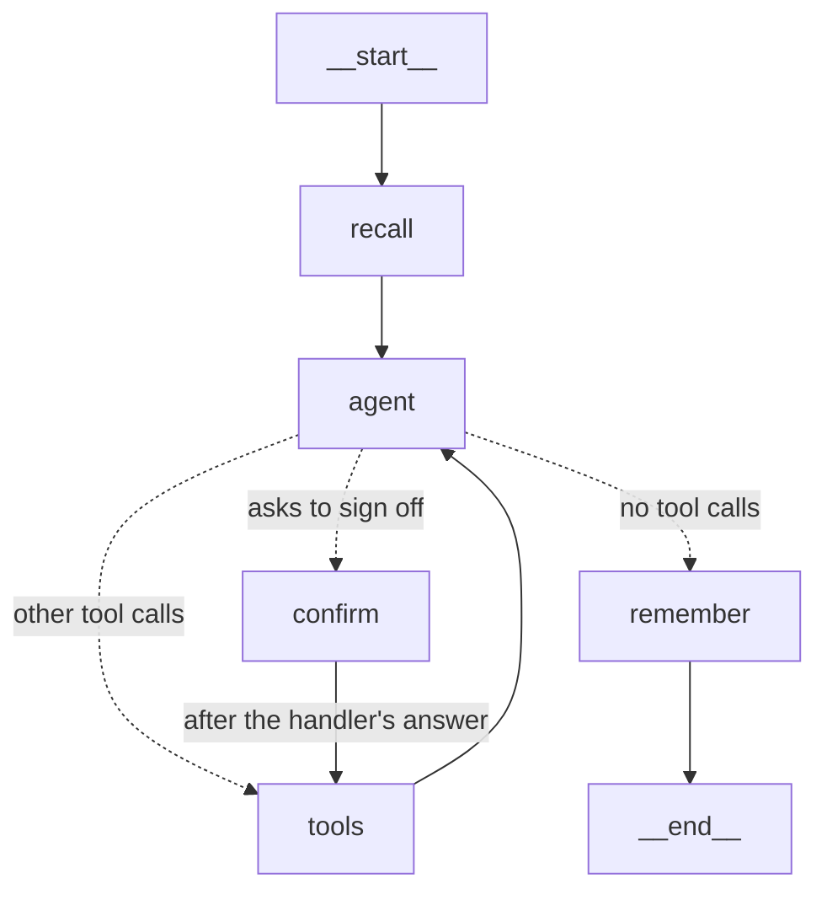

# Status

The pilot, the harness, durable state, our records, the swarm and the improver are built, from `docs/PLAN.md`, `docs/PLAN_HARNESS.md`, `docs/PLAN_DURABLE.md`, `docs/PLAN_RECORDS.md`, `docs/PLAN_SWARM.md` and `docs/PLAN_IMPROVE.md`. Run it with `npm run dev` (backend on :8000, the agent's AgentCore app on :8080, dashboard on :5173, context layer on :8006) and check it with `npm run check`, which needs no `.env`; its end-to-end tests use their own ports (8010, 5183 and stand-ins on 8003 to 8005), so `npm run dev` can stay up. `.env` holds `OPENROUTER_API_KEY`, `DATABASE_URL` (the Supabase session pooler), the Langfuse keys, `UNDERCOVER_API_KEY` (the agent's API key; the backend, the agent's service and a run all need the same one), and for sign-in `VITE_SUPABASE_URL`, `VITE_SUPABASE_PUBLISHABLE_KEY` and `HANDLER_PASSWORD` (quote it if it holds `#`). Handlers sign in with their emails in `data/handlers.json`, made as users in Supabase Auth with sign-ups off. The first time on a Supabase project, after pulling this (the tables changed), and whenever you want the queue back as it was, stop `npm run dev` and run `npm run seed`; it also takes the configuration and the recipe back to version 1 and empties the rounds. The agent needs `DATABASE_URL`; the backend and the tests fall back to SQLite (`backend/undercover.db`, gitignored) without it. Work one claim with `uv run -m agent CLM-1001`. Start dispatches, evaluations and improvement rounds from the dashboard.

- `backend/`: `docs/TECH_STACK.md` describes each module. New in the improver build: `auth.py` (who is signed in), `platform_settings.py` (the settings and the models allowed), `versions.py` and `diffs.py` (versions of the configuration and the recipe), `judge.py` and `grading.py` (Jev's grades for each explanation), `rounds.py`, `proposals.py`, `round_view.py`, `improver_view.py`, `version_scores.py`, `verdict.py` and `spending.py` (the rounds). `backend/instructions.py` and its route are gone: the instructions are version 1 in `data/claim_instructions.md`.
- `agent/`: the claim agent is built from its run's configuration version. New: `improver.py`, `improver_tools.py`, `improver_api.py`, `backend_http.py` and `rounds.py`; the service starts rounds, records a handler's decision and resumes the improver. The structure tests keep the claim agent's client from the scores and the rounds.
- `dashboard/`: sign-in, a header with the signed-in handler, and the pages Queue, Claim, Scoreboard, Evaluation, Improvement, Configuration and Settings, on shared components (page header, navigation, status pill, data table, diff view, confirmation dialog, empty and loading states), in light, dark or the computer's choice.
- `e2e/`: sign-in, settings, improvement and the earlier specs, each signing in through a stand-in for Supabase Auth.

The claim agent's tools take one of two routes (Week 3 Day 3, Phase 1 of `docs/PLAN_CONTEXT.md`): the Gateway's when `UNDERCOVER_GATEWAY_URL` is set, else direct, as before. A refusal by the Gateway's Policy is recorded on the claim, a payment it refuses holds the claim for a handler's sign-off (a new `hold_reason` column, so reseed after pulling this), and the model's tools take no claim or policy id. Nothing has been checked against a real Gateway: the tests use a stand-in. The context layer is built (Phase 2): `context/` serves data governance's seven files as seven read-only MCP tools (`uv run -m context`, on :8006, which `npm run dev` starts), the claim agent's tools from it work on both routes, the app seeds the plans and the two documents from `context/` (a `documents` table in place of the document sections, so reseed after pulling this), and the agent's API document has four operations since searching and reading the documents moved. `npm run check:context` checks the layer's own dependency group. Every decision record is complete (Phase 3): `calculate_payout` is an operation on the claim and keeps its calculation for the attempt, `decide_claim` takes who made the decision and refuses a record that falls short of claims manual section 14 (a 422 naming the section), and the claim holds its calculation, maker, time and the manual's version (new columns and a `payout_calculations` table, so reseed after pulling this). The agent has a memory of each customer (Phase 4): with `UNDERCOVER_MEMORY_ID` set, the graph saves each decided claim to AgentCore Memory in a `remember` node and the model gets `search_memory`, except for a claim the check referred and an evaluation's copy; with it unset nothing changes. It has only been tried against a stand-in store. Every step is on the claim page (Phase 5): steps have kinds and details (a `kind` and `details` on `claim_steps`, so reseed after pulling this), one recorder writes each tool call, lookup, memory search and refusal, and the claim page shows them with a Context used panel and the decision's whole record, the calculation line by line. Tests that record an approval go through one helper for each suite (`backend/tests/records.py`, `agent/tests/records.py`, `e2e/decisions.ts`). Rejecting a held payout, real payments and messages to customers are not built. Every claim is checked for hidden instructions before the claim agent sees it (Week 3 Day 2, Phase 2 of `docs/PLAN_SECURE.md`: `agent/screening.py`, the graph's first node); CLM-1901 is in the queue, which has 26 claims. The agent has its own API (Phase 3): `GET /api/agent/openapi.json` describes its six operations, a payment over the approval limit is refused with a 403, and a sign-off pays the claim in the one request (the backend no longer asks the agent's service to resume it). The dashboard's "Payment in progress" state can no longer be reached. The app is ready for Lambda (Phase 4): `npm run build`, `npm run check:server`, the backend serving the built dashboard, `backend.main.handler`, and an engine with no pool on Lambda; see Deployment in `docs/TECH_STACK.md`. Nothing has been deployed. The agent's API key is built (Week 3 Day 2, Phase 1 of `docs/PLAN_SECURE.md`): the backend refuses an agent route without it and a dashboard read without a handler, and only `/api/health` is open.

Checked live on Supabase with the default model, after the swarm build: see Phase 6 of `docs/PLAN_SWARM.md` (a dispatch at N=3 killed and carried on by one at N=25, two evaluations, the tag in Langfuse; claims are slower at N=25, with the time going to queueing for the backend's 4 database connections). Before it: a 5-claim capped run worked five claims; two over the limit waited; signing one off on the dashboard (Playwright MCP) showed it paid within five seconds with the handler and time; a run killed after its first steps carried on in the same run with the same threads, attempts unchanged and one decision each; a sign-off made while the agent's service was down was paid by the next run; Langfuse shows a held claim's session with traces from before and after the sign-off.

Checked live after the improvement build (Phase 8 of `docs/PLAN_IMPROVE.md`): a five-claim evaluation with the real judge (four decisions right, grade 1.184, $0.004); two rounds as Dana Whitfield from the Improvement page (the first proposal rejected with a reason, the next approved; both versions rolled back on time per claim, round 1 on a real 61 s against 43 s, round 2 because of a backend stall); Langfuse shows one session per round and the claims by their `run-` and `round-` tags; version 1's two held-out runs differed by less than the noise settings; a dispatch at N=25 ran, and Marcus Oyelaran was refused a sign-off and a settings change. Dana's sign-off was paid 1.9 s later, on a dispatch at N=25 with the limit lowered to $300 (put back to $1,000). Not checked live: `uv run -m agent` on `openrouter/free`, whose model sends line kinds the payout tool refuses. A lost database connection made the backend return 500s during a round; the engine now tests a connection before using it, and the dashboard's polling waits for each answer before asking again.

Checked live after the secure build (Phase 5 of `docs/PLAN_SECURE.md`), on the configured models after a reseed: an agent route with no key answered 401 and `/api/health` 200; `uv run -m agent CLM-1001` began with "Security check: no instructions found", approved $420.00 and paid it; a dispatch at N=5 (26 claims, $0.0235, 186 model calls) referred CLM-1901 with the check's reason, shown on the claim and in its steps, and the check cleared every other claim whose steps were read; an evaluation of the evaluation set's tiny five (37 model calls, $0.0048) flagged none; Dana's sign-off of CLM-1003 ($3,750.00) paid it once, with her name and the time; and after `npm run build` the backend served the dashboard on :8000 with Dana's 26 claims, in Lambda mode (`AWS_LAMBDA_FUNCTION_NAME` set, `DATABASE_URL` on port 6543, so Supabase's transaction pooler accepts the engine's `search_path` option) and with the variable unset. Eight claims across the dispatch and the evaluation were left for a handler after two failed attempts on Azure's 502 "high demand" answers; they are the provider's, and a new dispatch works them. Not checked live: `uv run -m agent` on `openrouter/free`, which has no endpoint under the zero-retention setting (a 404 at the check). Found and fixed: about 6 of 40 reads signed in as Dana by script got 401 "Your sign-in isn't valid" right after signing in. This Mac's clock runs a little behind Supabase's, so a fresh token's `iat` was ahead of it in 5 of 25 sign-ins (by 0.05 to 0.18 s) and PyJWT refused it as not yet valid; the backend now allows 10 s of clock difference (`CLOCK_LEEWAY_SECONDS` in `backend/auth.py`), and a token issued an hour ahead is still refused.

Checked live after the context build (Phase 6 of `docs/PLAN_CONTEXT.md`), on the configured models after a reseed, on the direct route with memory off: the context layer listed its seven tools on :8006; `uv run -m agent CLM-1001` approved $420.00 and paid it, `CLM-1005` approved $243.00 and `CLM-1006` $425.00, each with a complete record (the calculation line by line, "UnderCover Agent, configuration version 1" and the manual's version 2026.2); the check referred CLM-1901 with "Security check" as its maker and no calculation; a tiny evaluation (42 model calls, $0.0070) was cleared by the check for all five claims; and Dana's pages for CLM-1005 and CLM-1006 (Playwright MCP) show the tool calls, the lookups with where each came from, the Context used panel and the decision with its calculation. The first dispatch at N=25 stopped the backend: `claims.decide` read the manual's version while it held a database connection, so with the backend's pool of 4 connections four deciders waited for one another and every other request queued behind them, until the agent's calls timed out. It now reads the version before it takes the connection, `backend/tests/test_connections.py` checks that no main flow holds two, and the dispatch then ran in under a minute. The runs cost about $0.055 in all (dispatches of 165, 19 and 22 model calls and the evaluation's 42), plus three single-claim runs. Not checked live: the Gateway, the context layer on Lambda and the memory, which only the stand-ins exercise, and `uv run -m agent` on `openrouter/free`. Known: when the backend can't be reached, the dispatcher's error handler can't record a claim's failure, and the exception ends that dispatch's worker while its run stays running; the next start stops it once the app has not heard from it for five minutes (Phase 4 of `docs/PLAN_RUNTIME.md`).

Known: Supabase's session pooler keeps released connections open. After reseeding, a 5-claim run with the backend and the agent's service up showed 9 connections for user `postgres` in `pg_stat_activity` (Supavisor 8, Supabase's own `pg_net` 1), the same during and after the run, and still the same 5 seconds after every one of our processes had stopped. Our processes hold at most 8 (the backend 4, the agent's service 2, a run 2), so the count is within the brief's 12. The 11 to 16 seen earlier was probably the pooler holding more connections after several runs and restarts; it was not seen again. Rejecting a held payout, sign-in, real payments and messages to customers are not built, per `docs/SPEC.md`.

Week 3 Day 4, Phase 1 of `docs/PLAN_RUNTIME.md` (the approval comes back): the claim graph pauses with `interrupt()` for every approval waiting for a sign-off, whether over the limit or a payment the Gateway refused, and `remember` is now the last node of every path, so a claim is saved to the customer's memory after its payment or sign-off. An evaluation's copy never pauses. `agent/paused.py` reads a thread's pause from `interrupts` and what the app's record answers it with; `agent/resumption.py` and the service's `resume_claim` route refuse a claim that isn't paused, one nobody has signed off and one that doesn't exist (a 409 with the reason), and otherwise work it in the background; the backend asks for that after a sign-off has been paid, and a failure is a warning, never an undo. Known: a sign-off the agent never learned of leaves the claim's thread paused and its memory unsaved until the next dispatch works it. Not checked live yet (Phase 5).

Phase 2 of `docs/PLAN_RUNTIME.md` (sign off or send back): a senior handler can send an approval waiting for sign-off back to the agent with a note (`POST /api/claims/{id}/send-back`, 1 to 1,000 characters). One conditional update decides between a sign-off and a send back; the decision goes to the new `sent_back_decisions` table with the note, who and when, the claim's own decision, calculation and hold are cleared, and the claim is `sent back` (new table and column `resume_heard_on`, so reseed after pulling this). The agent's `take_claim` moves it to in progress once; a second taker gets a 409. A dispatch works sent-back claims and leaves one alone whose resume the app heard from in the last five minutes (`backend/quiet.py`); a resume tells the app it is working every minute (`agent/heartbeat.py`). The graph's `approval` node forgets the decision on a send back, adds `agent/review_message.py`'s message (a review to check against the policy wording and the manual, a referral if they don't support it) and goes back to the agent with its model calls reset. The claim page shows each sent-back decision with its note beside the current one, with Sign off and Send back beside each other for a senior handler. Not checked live yet (Phase 5).

Phase 3 of `docs/PLAN_RUNTIME.md` (the agent as an AgentCore app): `agent/service.py` is gone. The agent is `agent/entrypoint.py`'s `BedrockAgentCoreApp`, which `npm run dev` serves on 127.0.0.1:8080 (stop `agentcore dev` first) and `runtime/main.py` runs on Runtime; each payload to `/invocations` names an operation (`start_dispatch`, `start_evaluation`, `start_round`, `decide_proposal`, `resume_claim`, `health`; `stop_round` is the app's own), answered `accepted` or `refused`, or a 400 saying what is wrong. The agent gets ready on its first request (`agent/readiness.py`: on Runtime it fetches `OPENROUTER_API_KEY`, `UNDERCOVER_API_KEY` and `DATABASE_URL` from AgentCore Identity), registers its work as async tasks so the ping says `HealthyBusy` while anything is going, and off Runtime refuses a request without `Authorization: Bearer <the agent's key>` apart from the health check. The agent reads the app's address as `UNDERCOVER_API` (it was `UNDERCOVER_BACKEND`; the dashboard's proxy still uses that). The app asks it through `backend/agent_service.py` on the laptop route or, with `UNDERCOVER_AGENT_RUNTIME` set to the runtime's ARN, through boto3, one attempt each (the run is still created by the agent: step 4 moves that). `pyproject.toml` has a `runtime` group, checked by `npm run check:runtime`, and `agentcore/` and `runtime/` are in git as the platform team wrote them. Not checked live yet: `uv run --env-file .env --isolated --only-group runtime python -m runtime.main` answering the health check (Phase 5), and nothing has been deployed.

Phase 4 of `docs/PLAN_RUNTIME.md` (the app keeps one run at a time): the app creates the agent's work. `backend/starts.py` stops work that has gone quiet, refuses a start while one piece of work is going (a 409 naming it: "A dispatch is already running"; the database's unique index decides between two starts at the same moment), creates a dispatch's or an evaluation's run, a round or a handler's review in a short transaction it commits, and asks the agent for it by id (`work_run`, `work_round`, `carry_round_on`). When the agent didn't take the work (never connected, an error answer, a refusal) the app undoes it: a run is stopped with the reason, a new round is stopped, a review is cleared (the proposal waits again, its version gone, the round as it was); a timeout leaves it going and tells the handler to reload. The agent no longer creates runs or rounds, records reviews or marks anything stopped when it gets ready; it refuses a run that isn't running and a round that isn't open, tells the app every minute that it is working (`runs.heard_from_on`, set by `POST /api/runs/{id}/heard`, covering a round's evaluation through its stretch), and when its work fails it stops only that run or round's stretch (`POST /api/runs/{id}/stop`) with the reason. Work the app hasn't heard from for five minutes is stopped by the next start with "The agent stopped answering"; `runs.stopped_reason` and `rounds.stopped_reason` are new columns (reseed after pulling this), shown on the queue and the improvement page. The improver's model is written once, in `backend/model_used.py`, and the agent reads it from the stretch's record. The routes the agent used to create runs and rounds with, and `stop-unfinished`, are gone; the backend's tests make state through test-only routes (`backend/tests/creating.py`). Not checked live yet: a dispatch at N=25 and the dashboard refusing a second start (Phase 5).

Checked live after the runtime build (Phase 5 of `docs/PLAN_RUNTIME.md`), on Supabase after a reseed, on the default models, the direct route and memory off, as Dana Whitfield: the agent on 8080 answered `{"operation": "health"}` without a key, refused `work_run` without one (401) and answered a payload missing an input with a 400 saying which; a dispatch at N=25 worked the 26 claims in 171 seconds for $0.044 (228 model calls) with `/api/health` answering within 0.83 s throughout, a second dispatch and an evaluation were refused while it ran with "A dispatch is already running", and its summary (18 approved, 5 declined, 3 referred, three waiting for sign-off) matched the claims' own records; CLM-1011 ($1,150.00) sent back with a note was decided again by the agent, which answered the note in its reason, and waits for sign-off again, with its page showing the earlier decision with its calculation, the note with Dana and the time, and the new decision; CLM-1008 ($2,240.00) signed off was paid once and its page shows "Signed off by Dana Whitfield" with the time (the claim's step says "Signed off by HND-01"); an evaluation of the held-out set's five tiny claims finished, graded, for $0.0083 (53 model calls), with the check clearing all five. The Playwright MCP server's navigation hung, so the pages were read through Chrome instead, signed in with a session token for Dana. `uv run --env-file .env --isolated --only-group runtime python -m runtime.main` served the agent on 8080 and `{"operation": "health"}` posted to `/invocations` answered `{"healthy": true}`, getting ready against Supabase with the backend down. Not checked live: the Gateway, the Memory, AgentCore Runtime and Identity, which only stand-ins exercise; whether the runtime's role may read its credentials from Identity and whether a session's work survives the one-minute idle timeout are for your deploy to settle.

Week 3 Day 5, Phase 1 of `docs/PLAN_COPILOT.md` (the app's side of the Copilot): the app keeps a handler's Copilot conversations (new tables `copilot_conversations`, `copilot_messages` and `copilot_steps`, so reseed after pulling this), one turn at a time. A message begins a turn by one conditional update (a second message while it works is a 409; a turn working for over 20 minutes reads as stopped and takes a new message; a turn waiting for a confirmation is never stopped and refuses a message) and the app asks the Copilot through `backend/copilot_service.py`, which posts to `UNDERCOVER_COPILOT` (default `http://127.0.0.1:8081`) with no key, or invokes `UNDERCOVER_COPILOT_RUNTIME` in the conversation's own session, retrying Runtime's busy session a few times. The payload carries the handler's sign-in, which is in no table; a turn the Copilot doesn't take is undone with its reason. The Copilot calls the app back as the handler to record its steps, wait for a confirmation, answer or fail (`backend/copilot_routes.py`), and reads through `backend/lookup_routes.py`: customers by name or id with their policies and claims in the queue, a policy with its plan's limits, the payments over the approval limit with their sign-offs, and what needs a handler (held payouts, referred or left claims, sent-back claims not yet worked). `GET /api/copilot/evaluations` gives measures and costs and never a handler's decision. Another handler's conversation is a 403. `agent_laptop` and `agent_runtime` now take the address or ARN and the session as arguments, and `agent_answer.taken` reads an answer once for both services; the claim agent's calls are unchanged. The agent's API document still has its four operations. The Copilot itself isn't built yet: the tests use a stand-in (`copilot_stub` in `backend/tests/conftest.py`).

Phase 2 of `docs/PLAN_COPILOT.md` (the Copilot's loop): the Copilot is a hand-written LangGraph graph in `agent/copilot_*.py` (`copilot_graph.py`: recall, agent, tools, remember), run a turn at a time by `copilot_turns.work_turn`, which first asks the app who is signed in (a refused sign-in ends the turn before any model call) and then tells the app the answer with its model calls and cost, or why it failed. The handler's sign-in lives only in `CopilotContext` (never checkpointed) and in the header of each call `copilot_api.py` makes to the app; the agent's key is never sent (`backend_http.request` takes headers, `send` adds the key, and structure tests keep the Copilot off both). Each tool call is a card in the app's record (`copilot_recording.py`), working then done, refused or failed, with a context-layer answer's files and owners. The Copilot has the claim agent's seven context lookups (written again for its own context, through `copilot_route.py`, which refuses the app's target), reads of claims, customers, policies, the latest dispatch, evaluations, settings and what needs a handler, and three actions: start a dispatch, start an evaluation, send a decision back. A turn is limited to 25 model calls; a conversation stopped partway is carried on by answering its unfinished tool calls. With `UNDERCOVER_COPILOT_MEMORY_ID` set, a `recall` card looks up the handler's memory and the turn's end saves their message and the answer (`copilot_memory.py`); with it unset neither happens. Not yet: the pause before a sign-off, waiting for a run, and the success criteria (Phase 3).

Phase 3 of `docs/PLAN_COPILOT.md` (the pause, the wait and the success criteria): a reply that asks to sign off a claim goes to `copilot_confirm.py`'s node before the tools. In code it declines a handler who can't sign off over the limit and a claim that isn't waiting for a sign-off, with no card and no pause and the reason for the model to read; otherwise it reads the claim, the customer, the payout and the agent's reason from our records and pauses with `interrupt()` on a card the app keeps with the conversation (`kind`, `claim_id`, `customer`, `payout`, `reason`). The app sends the card back with the handler's answer, and the node declines if the claim has changed since. The `sign_off_claim` tool refuses without the node's confirmation in the state, so a second sign-off in one reply is answered "one at a time" and a Cancel is a refused card saying nothing was signed off. Nothing is written before the pause, and an answer resumed by a freshly built Copilot on the same saved state signs off once. `start_dispatch` and `start_evaluation` take `wait`: the Copilot then polls the run every five seconds in code (`copilot_waiting.py`, no model call) and stops after 15 minutes, saying where to follow it. `check_success_criteria` runs a whole held-out evaluation and waits, then `copilot_criteria.py` works the three criteria out in `Decimal` (straight through against 70%, accuracy against `objective_accuracy`, and the app's count of payments over the approval limit and their sign-offs); a failed, stopped or refused evaluation gives no figures for the first two and the third is still reported.

Phase 4 of `docs/PLAN_COPILOT.md` (the Copilot as an AgentCore app): `agent/copilot_entrypoint.py` is the Copilot's `BedrockAgentCoreApp` (`npm run dev` serves it on 127.0.0.1:8081 beside the claim agent's on 8080; `npm run dev:copilot` alone), `runtime/copilot.py` is the file Runtime starts, and `agentcore/agentcore.json` has a second runtime, `copilot`, deployed as `undercover_default_copilot` from the same package with its own role policy (`runtime/copilot_policy.json`: the Gateway and `undercover_copilot_memory-*`); the stack gives each runtime its own settings (`UNDERCOVER_COPILOT_MEMORY_ID` to the Copilot only). Each payload (`start_turn`, `answer_confirmation`, `health`; `copilot_operations.py` on `payloads.py`, which the claim agent's `operations.py` now shares) is answered `accepted` at once and the turn goes on as a registered async task (the ping says `HealthyBusy`), or `{"healthy": true}`, or a 400 that says what is wrong and never echoes the sign-in; it asks for no key. `copilot_readiness.py` gets ready on the first request and fetches `OPENROUTER_API_KEY` and `DATABASE_URL`, never the agent's key. Checked: `npm run check:runtime` imports both runtime files; with only the `runtime` group the Copilot's app answered `{"operation": "health"}` with `{"healthy": true}` (run on 8081, since `runtime/copilot.py` serves on 8080 as Runtime needs); the CDK app, run directly (nothing deployed), synthesizes both runtimes and the Copilot's role with its own memory policy. A test serves the Copilot's app on a local port with a stub model and a message to the app's route comes back as steps and an answer. Not deployed, and not checked against a real Runtime, Memory or Gateway.

Phase 5 of `docs/PLAN_COPILOT.md` (the sidebar): the dashboard has the Copilot beside every page (`dashboard/src/components/CopilotSidebar.tsx` and the components `Conversation`, `StepCard`, `ConfirmationCard`, `AnswerText`, `Composer` and `ConversationList`; `useCopilot.ts`; `sidebarPreference.ts`). It is open the first time, collapses to a slim tab the browser remembers, remembers which conversation it showed so a reload keeps a waiting card, and opens over the page on a window under 900 px. Answers are markdown (`react-markdown`, `remark-gfm`: new dependencies), with claim ids linked and raw HTML shown as text. The sign-in is renewed before a message or an answer when it has under 20 minutes left. `e2e/copilotStandIn.mjs` (port 8007) plays a scripted turn through the app and `e2e/copilot.spec.ts` drives it; two existing specs were scoped to the page now that the sidebar also names the handler and has a message box. Checked in the browser (Playwright MCP) against the stand-in in light and dark mode: the greeting and suggested questions, the cards with their states, the confirmation card, a formatted answer with its usage line, and the narrow window.

Phase 6 of `docs/PLAN_COPILOT.md` (the live checks): after a reseed, as Dana Whitfield on the default model, the five handover questions all worked in one conversation: the dispatch of 10 agents and what needs a handler; why CLM-1018 needed her; CLM-1008 sent back with her note, which its page shows, and decided again by the agent; a sign-off of CLM-1011 that waited on its confirmation card (kept over a page reload) and then paid $1,330.00 once as Dana; and the success criteria on a whole held-out evaluation (88.0% straight through, 76.0% accuracy, 1 of 1 over the limit, matching the Scoreboard). After restarting `npm run dev` the same conversation continued with its history. Marcus Oyelaran's sign-off request was declined with the reason and no card. No sign-in token is in any database table. The runs cost about $0.08: the dispatch about $0.04, the evaluation $0.037, the Copilot's own turns under $0.003. Nothing is deployed to AWS: the Gateway, the Memory and the Runtime are checked only by the stand-ins here.

Week 3 Day 5, Phase 1 of `docs/PLAN_GUIDE.md` (a user guide, not in a brief): `guide/index.html` and `guide/guide.css` are a static page with a section for each screen of the dashboard and the Copilot, each with a few sentences for a handler and a picture in light and dark (`guide/images/<name>-light.png` and `-dark.png`), a theme switch that starts from the computer's setting and is remembered, and the five Copilot questions to try. It opens from the file with no server. The pictures are real: `npm run guide` makes them. `backend/tests/test_guide.py` checks every picture has alt text, a file and its light or dark pair, every section has a heading and a description, and the page names no token, address of a laptop or AWS identifier.

Phase 2 of the guide: `npm run guide` (`scripts/guide.ts`, with helpers in `scripts/guide/`) takes the 26 pictures from the running app. Stop `npm run dev`, run `npm run seed`, start `npm run dev`, then run it: it needs a fresh seed, since it has the Copilot work the whole queue. It signs in as Dana Whitfield and Marcus Oyelaran with the password from `.env`, which is never printed, and takes about 6 minutes. It has the Copilot work the queue with 10 agents and show what needs a handler, sends one claim back, asks for a sign-off and cancels the confirmation card so nothing is paid, runs an evaluation of the 5 tiny held-out claims, and has Marcus ask for a sign-off to show the refusal. It writes each picture in light and dark to `guide/images/`, removes any file the page doesn't name and says if the page names one it didn't make. It isn't part of `npm run check`, which needs no model. A run cost about $0.034 for the dispatch, $0.0013 per claim for the evaluation and half a cent for the Copilot's own turns. The Improvement page's picture shows its empty state, since a round costs far more than the guide is worth. Look at every picture before committing it.

Phase 3 of the guide, publishing: `.github/workflows/guide.yml` publishes only `guide/` to GitHub Pages when `main` gets a push that changes `guide/` or the workflow, and it can be run by hand from the repo's Actions tab. To turn it on, once: in the repo on GitHub, Settings > Pages > Source: GitHub Actions, then push to `main`. The guide's address is `https://<your GitHub name>.github.io/undercover/`; the first run of the workflow shows it. To refresh the pictures after a change: reseed, `npm run dev`, `npm run guide`, look at every picture, commit, and push to `main`. The guide is live at that address: I checked it from outside the laptop, with all 26 pictures loading, the theme switch changing and remembering the theme, and no sideways scrolling at phone width.

Phase 1 of `docs/PLAN_APPEALS.md` (appeals to the ombudsman, from `docs/APPEALS.md`): the records and the documents. `backend/tables.py` has `appeals` (keyed by the claim's id: a claim has at most one appeal) and `redress_payments` (keyed by the claim's id too: redress is paid once), and `backend/statuses.py` has `AppealStatus` (with the ombudsman, upheld, not upheld). `data/appeals/` holds eight earlier claims, CLM-1601 to CLM-1608, decided by handlers before the pilot with complete decision records (the one paid over the limit carries Dana Whitfield's sign-off), and an appeal against each: two with the ombudsman, three upheld (one with its redress paid, two waiting) and three not upheld. `backend/seed_data.py` reads the folder and `backend/appeal_seed.py` turns it into rows. After a seed the queue has 34 claims, 26 waiting and 8 decided; the evaluation sets and the waiting claims are unchanged. The context layer's files carry the complaints rules: the policy wording is at 2026.2 with a new section 13 and three more definitions, the claims manual at 2026.3 with changes to sections 3, 9, 11, 12, 13 and 14 and a new section 15, and the claim rules, glossary and data dictionary have the appeal entries. No route or screen uses any of this yet. The deployed database needs a reseed and the context layer a redeploy to see it.

Phase 2 of `docs/PLAN_APPEALS.md`: appeals in the app. `backend/appeals.py` is the one home of an appeal's state: record an appeal on a claim with a final decision (approved and paid, or declined) and record the ombudsman's outcome, with `NewAppeal` and `Outcome` as the request bodies. `backend/redress.py` pays an upheld appeal's redress once, from the three recorded amounts, for a handler who can sign off. `backend/appeal_check.py` is the app's check for instructions hidden in an appeal's text, through the `openrouter` package as `judge.py` is, on the model `backend/model_used.py` names (`for_appeal_check()`): it runs before anything is written and holds no connection, and when it can't answer the recording is refused with a 503. A marked appeal is recorded all the same, with the check's reason and cost. `backend/appeal_view.py` gives an appeal as the dashboard reads it and as a model reads it, which leaves out a marked appeal's grounds and reason; `backend/appeal_figures.py` works out the Appeals page's figures; `backend/appeal_routes.py` has the routes (`POST /api/claims/{id}/appeal`, `.../appeal/outcome`, `.../appeal/redress`, `GET /api/claims/{id}/appeal`, `GET /api/appeals`, `GET /api/appeals/figures`, and `GET /api/copilot/appeals` and `/{id}` for the Copilot). Every one takes a signed-in handler and none takes the agent's key; the agent's own API is as it was. `GET /api/claims/{id}` gains `customer_appeals`, one line for each appeal on the customer's claims, so the claim agent reads no appeal text. `GET /api/queue/needs-a-handler` gains `appeals_waiting_for_an_outcome` and `redress_waiting_for_sign_off`. A structure test says only the appeal modules touch an appeal's two free-text columns. `docs/SPEC.md` has the appeals and the amended payment rule. No screen or Copilot tool uses them yet.

Phase 3 of `docs/PLAN_APPEALS.md`: the Copilot's appeals. `agent/copilot_appeal_tools.py` has `list_appeals`, `get_appeal`, `get_appeal_figures`, `record_appeal`, `record_appeal_outcome` and `pay_redress`, at module level like the rest; the reads and the answers to the recordings are the app's reads for a model, so a marked appeal's grounds and reason never reach the model, and `agent/tests/test_structure.py` checks `copilot_api.py` never calls the dashboard's whole reads. The pause serves both payments: `agent/copilot_confirm.py` checks in code that the handler can sign off and that the payment can be made, then reads the card from our records (kind `sign_off` or `redress`, the redress card showing the claim, the customer, the three amounts and the ombudsman's reason, which a marked appeal leaves out) and pauses; `pay_redress` refuses without the confirmation the pause records, and a second payment in the same reply is answered "One payment at a time". The state's `confirmed` now holds the tool and the claim, such as `pay_redress:CLM-1602`. The instructions say what appeals are and what the Copilot may do with them. One limit to know: when a handler gives the Copilot an appeal's grounds in a message, the model has read them already, whatever the check later finds; the check marks the appeal for everyone who reads it afterwards. The dashboard's confirmation card doesn't show a redress card yet (Phase 4).

Phase 4 of `docs/PLAN_APPEALS.md`: the dashboard. A new Appeals page (`/appeals`, `pages/AppealsPage.tsx`, in the navigation beside the Scoreboard) shows the six figures (`components/AppealFigures.tsx`), a filter by status and every appeal with its claim, customer, plan, our decision, status label, decision date and redress. A claim's page (`pages/ClaimPage.tsx`) shows the appeal's label beside its status and `components/AppealPanel.tsx` below the decision: with no appeal on a decided claim (`appealRules.ts` says which claims have a final decision) it offers `RecordAppealForm`; an open appeal offers `RecordOutcomeForm`, which asks for the three amounts only when upheld and needs them to come to more than zero; an upheld appeal with unpaid redress offers `PayRedress` (a confirmation first) to a handler who can sign off, and tells anyone else why they can't; an appeal the check marked shows its reason. The appeals calls are in `appealsApi.ts`, on `getJson` and `post` from `api.ts`, which still has the only `fetch`. The Copilot's confirmation card has a `redress` kind showing the three amounts, the total and the ombudsman's reason (left out of a marked appeal), answered with Pay redress or Cancel. The header now wraps, so the signed-in handler never slides under the sidebar once a sixth page is in the navigation. The end-to-end specs have an Appeals spec and a Copilot redress turn; the judge's stand-in also answers the appeal check (a text that says to ignore the rules or approve in full is marked). Checked in the browser in light and dark and at 390 px with a Playwright script against the stand-in stack, not the Playwright MCP server: the Appeals page, a claim in each appeal state, the redress card and Marcus's view. The queue page lists the eight earlier claims among the waiting ones, in the order submitted, so its table now shows "decided" rows between them.

Phase 5 of `docs/PLAN_APPEALS.md`: the documents and the guide's page. `docs/SPEC.md` has the appeals and the amended payment rule, `docs/TECH_STACK.md` names each new module's job, `docs/CODE_STANDARDS.md` has rule 9b (who may read an appeal's texts, the check's one home and the dashboard's appeals calls), and `data/README.md` describes `data/appeals/`. The guide has an Appeals section with two pictures (`appeals` and `claim-appeal`, in light and dark), which are grey placeholders until `npm run guide` takes the real ones; `scripts/guide.ts` takes both from the seed, before its dispatch, so they show the eight starting appeals. To run the appeals work: `npm run seed` with `npm run dev` stopped, then `npm run dev`, and open Appeals. To see it on AWS: reseed the deployed database (the tables are new and the seed drops the schema), redeploy the app's Lambda, redeploy the context layer (its files and versions changed), and run `agentcore deploy` (the Copilot's tools changed).

Phase 6 of `docs/PLAN_APPEALS.md`: the live checks, after one reseed, on the default model through `npm run dev`. `npm run guide` took every picture, the Appeals ones included, and each was looked at in both themes (no cut-off text, token, `.env` value or AWS identifier). As Dana Whitfield, the Appeals page showed the eight appeals in their five states with figures that matched the records; the Copilot's answer to "What appeals do we have, and how many has the ombudsman upheld?" agreed with it; "Pay the redress on CLM-1602" showed the redress card with the three amounts and the ombudsman's reason, the card survived a reload, and Pay redress paid it once with Dana's name and the time. The Copilot then recorded an appeal and an upheld outcome with $910.00 of redress on CLM-1015, an appeal and a not upheld outcome on CLM-1016, and an appeal on CLM-1024 whose grounds told the AI to approve in full: the real model's check marked it, and the Copilot said only that its text was withheld and why. As Marcus Oyelaran, "Pay the redress on CLM-1603" was declined with the reason and no card. A search of all 40 tables for the sign-in tokens found none. The live run found one fault the tests could not: the check called OpenRouter's chat endpoint at the bare origin and got a 404 page, which surfaced as a 500. It now calls `/api/v1`, any failed call is a 503 that saves nothing, and the end-to-end stand-in answers only at the right path. The run cost about 5 cents: $0.0400 for the dispatch, about $0.0085 for the five-claim evaluation, and under a cent for the Copilot's turns and the checks of appeal text. Two pictures (`copilot-confirm`) were retaken in a taller window after the run, since the long reason cut off the card's buttons; `scripts/guide.ts` now takes them that way.

The Copilot's graph (`agent/copilot_graph.py`, drawn by LangGraph from `build_copilot_graph`; the dotted lines are the conditional edges after `agent`, and the 22 tools sit in `tools`):

The first message after a pause failed with a 502 on AWS (found on the deployed Copilot, from its conversation record and the runtime's logs): both runtimes shut a session's container down after 60 idle seconds, so the next message met a container still starting, and Runtime answered 502 before running anything. The app now sends a Copilot payload again, after 3 s, up to 4 tries in all, when the answer is that 502 (`RuntimeNotReady` in `backend/agent_runtime.py`, retried in `backend/copilot_service.py` as it is for a busy session); any other refusal is still sent once. A refusal is logged with the runtime, operation and session, never the payload or the sign-in. The Copilot's runtime now stays up 900 seconds between messages (`agentcore/agentcore.json`). Redeploy both for it to take effect: the app's Lambda, and `agentcore deploy` for the runtime's lifecycle setting.

To put a change on AWS, `docs/DEPLOYING.md` says what to run for each kind of change: the app, the context layer, the two agents, the database, the Gateway, the app's settings and the user guide.
